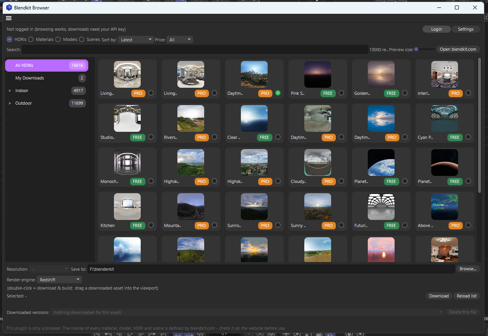

<p align="center">
  
</p>

<h1 align="center">Blendkit Browser for Cinema 4D</h1>

<p align="center">
  Browse, search, download and import <b>Blendkit</b> assets &mdash; HDRIs, materials, models and scenes &mdash;
  without leaving Cinema 4D 2027.
</p>

<p align="center">
  <a href="https://aimarnl.github.io/blendkit-browser-c4d/">Project page</a> ·
  <a href="https://github.com/AimarNL/blendkit-browser-c4d/releases">Download</a> ·
  <a href="https://github.com/AimarNL/blendkit-browser-c4d/issues">Report an issue</a>
</p>

---



*The browser window inside Cinema 4D 2027 (Models tab, Redshift selected as render engine).*

> [!WARNING]
> **Color space and render engine support may not be correct.**
> Color spaces (for example sRGB vs. linear for textures and HDRIs) and the materials and lights built for each render engine (Arnold, Redshift, Octane, Corona, V-Ray) are **not** fully tested and **may be wrong or incomplete**. Always check the result in your own scene, and please open an issue if something looks off.

> [!IMPORTANT]
> **This plugin is only a browser.** It does not host, sell or relicense any content. The license of every material, model, HDRI and scene is defined by **[blendkit.com](https://www.blendkit.com)** and by the author of each asset. Check the license of each asset on the website before you use it, especially in commercial work. This is an unofficial, third-party tool and is not affiliated with Blendkit.

## What is it?

[Blendkit](https://www.blendkit.com) (formerly BlenderKit) is an online library of Blender assets. **Blendkit Browser** is a Python plugin that shows that library in a Cinema 4D window and turns the assets you download into things Cinema 4D can use: a sky for your render engine, a material, or a model merged into your scene.

Because the assets are Blender files, the plugin runs **Blender in the background** to convert them. You do not need to open Blender yourself.

## Features

- **Four asset types:** HDRIs, Materials, Models and Scenes.
- **Website-like browsing:** category sidebar with counts, thumbnail grid, sort, price filter (All / Free / PRO), search and a preview-size slider.
- **Render engine selector:** Arnold, Redshift, Octane, Corona, V-Ray or C4D Standard.
- **Double-click to download and build.** Green status dot on cards already on disk, *My Downloads*, and a *Downloaded versions* list with *Delete this file*.
- **Drag and drop** downloaded assets into the viewport. Models are merged into the open scene instead of replacing it.
- **Right-click an asset card** to open its page on blendkit.com or copy the link.
- **First-run license notice** that explains where asset licenses come from, plus a small reminder line under the plugin.

## Requirements

- Cinema 4D **2027** on **Windows** (drag and drop uses the Windows shell).
- **Blender** 4.x or newer (free). The plugin finds it automatically, or you can set the path in *Settings*.
- A Blendkit account and **API key** for downloads. Browsing works without logging in.
- *Optional:* Arnold (C4DtoA), Redshift, Octane, Corona or V-Ray, depending on the render engine you choose.

## Installation

1. Download the latest release zip, or clone this repository.
2. Copy the **`BlendkitBrowser`** folder into Cinema 4D's plugins folder  
   (*Edit > Preferences > Open Preferences Folder*, then `plugins`). Remove any older copy first.
3. Restart Cinema 4D and open **Extensions > Blendkit Browser**.
4. On first launch, read the license notice, tick the box and press **Continue**. blendkit.com opens in your browser.
5. Press **Login**, choose *Open profile page*, copy your **API key** from the website and paste it into the plugin.

```
BlendkitBrowser/
  BlendkitBrowser.pyp        plugin entry point
  bkit/                      plugin code (UI, API, import, materials)
  blender_scripts/           scripts run by Blender in the background
  res/icon.png               plugin icon
```

## Quick start

1. Open **Blendkit Browser** and log in.
2. Pick a tab (HDRIs, Materials, Models or Scenes), a category, and search or sort.
3. Choose the **Render engine** and, for HDRIs and materials, the **Resolution**.
4. **Double-click** a card (or press **Download**). Blender converts the asset in the background and it is built in Cinema 4D.
5. Once an asset is on disk (green dot) you can **drag it into the viewport**.

## Asset types

| Type | What you get |
|---|---|
| **HDRI** | The image is used directly (or extracted from the .blend) and set up as Arnold Sky, Redshift Dome Light or C4D Sky, or the Octane / Corona / V-Ray equivalent. With an Arnold Sky or Redshift dome selected, the HDRI is applied to it. |
| **Material** | Image textures wired to the Principled BSDF (color, roughness, normal / bump, displacement, alpha, emission) are rebuilt as a material for the chosen engine. **Procedural materials are not supported.** |
| **Model** | Exported by Blender as FBX (default) or GLB and merged into the scene under a Null. Materials are rebuilt for the chosen engine and put on the imported objects. |
| **Scene** | Same as a model, but cameras and lights are kept. Everything lands under one Null. |

### Render engines

| Engine | HDRI | Materials and models |
|---|---|---|
| Arnold | Arnold Sky (via C4DtoA) | A C4D material is built and converted with Arnold's own commands |
| Redshift | RS Dome Light | OpenPBR node material (falls back to Redshift Standard, then C4D Standard) |
| Octane / Corona / V-Ray | The renderer's own environment, sky or dome command, then the texture slot is filled | A C4D material is built and the renderer's own converter command is run; if it is not found you get a C4D Standard material and a note |
| C4D Standard | C4D Sky | C4D Standard material |

## How it works

1. The asset file (a `.blend` or an image) is downloaded with your own API key.
2. **Blender runs in the background** with the scripts in `blender_scripts/` and extracts the HDRI, material textures or an FBX / GLB model.
3. The result is cached in the folder set in *Settings > Save assets to*.
4. The plugin imports it into Cinema 4D and builds the materials for the selected render engine.

For models, drag and drop hands the converted file to Cinema 4D as a real file drop, so it is merged into the open document. Afterwards the file is imported again with the rebuilt materials.

## Troubleshooting

| Problem | What to do |
|---|---|
| Plugin does not appear | Check the Cinema 4D Console at startup. The line `Blendkit Browser v... registered` should be there. Remove any older copy of the plugin folder and restart. |
| Downloads fail or assets are locked | A Blendkit account and API key are required, and your plan decides what you can download. PRO / locked assets are not bypassed. |
| "Blender not found" | Install Blender 4.x or newer, or set its path in *Settings*. |
| A material looks wrong | Try another render engine, and check the color space of the textures. See the warning at the top. |
| A material is missing or plain | Procedural Blender materials are not supported yet. |
| Thumbnails missing | Thumbnails in WebP format cannot be read by Cinema 4D. |
| Something else | *Settings > Diagnostics* writes the raw API responses, and everything is logged to `blendkit.log`. Both are in Cinema 4D's `prefs/BlendkitBrowser/` folder. |

## Plugin ID

`PLUGIN_ID = 1000011` at the top of `BlendkitBrowser/BlendkitBrowser.pyp` is an **unregistered development ID**. Register your own free ID at [developers.maxon.net](https://developers.maxon.net/) before distributing a modified build.

## Status and limitations

- Developed and used with Cinema 4D 2027 on Windows.
- **Color space handling and the Arnold, Redshift, Octane, Corona and V-Ray setups may not be correct.** The Octane, Corona and V-Ray setups depend on commands from those renderers and fall back to C4D Standard materials when a command is missing.
- Procedural materials, animation and Geometry Nodes assets are not supported.
- Windows only.
- The plugin uses the same public API conventions as the official Blender add-on, with your own key. Please check Blendkit's terms for third-party tools.

## Contributing

Issues and pull requests are welcome. When reporting a problem, please include your Cinema 4D version, the render engine you selected, the Console output and `blendkit.log`.

## License

[MIT](LICENSE) © 2026 Aimar

This license covers the plugin code only. It does **not** cover any asset downloaded from Blendkit; those follow the license shown on blendkit.com.

## Disclaimer

Provided as is, without warranty. Not affiliated with, endorsed by or sponsored by Blendkit, Blender, Maxon or any render engine vendor. All trademarks belong to their owners.
